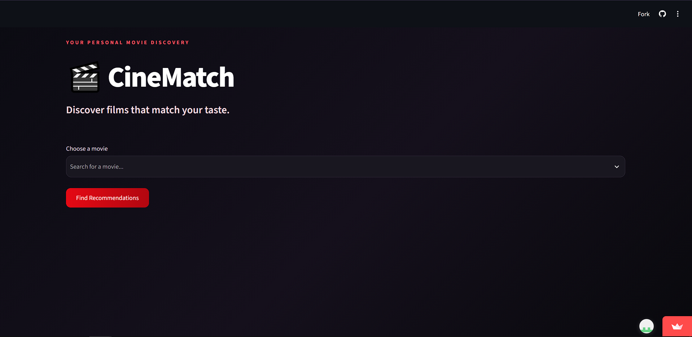

# 🎬 CineMatch — Movie Recommendation System

Discover your next favorite movie with **CineMatch**, a movie recommendation web app built using Python and Streamlit.

## 🚀 Live Demo
👉 [Try CineMatch](https://discover-cinematch.streamlit.app/)

## ✨ Features
- 🔎 Search and select movies from a large movie dataset.
- 🎯 Get personalized movie recommendations based on movie similarities.
- 🎭 Recommendations consider genres, plot descriptions, cast, directors, and keywords.
- 🖼️ Movie posters displayed alongside recommendations.
- 🌐 Interactive web interface built with Streamlit.

## 🛠️ Tech Stack
- Python
- Pandas and NumPy
- Scikit-learn
- TF-IDF Vectorization and Cosine Similarity
- Streamlit
- TMDB movie data

## 👨‍💻 Author
**Akshay**

[GitHub Repository](https://github.com/akshays-232/CineMatch) · [Live App](https://discover-cinematch.streamlit.app/)

## 📸 App Screenshots

### 🏠 Home Page

### 🔍 First Movie Search

### 🎬 First Recommendations

### 🔍 Second Movie Search

### 🎬 Second Recommendations

